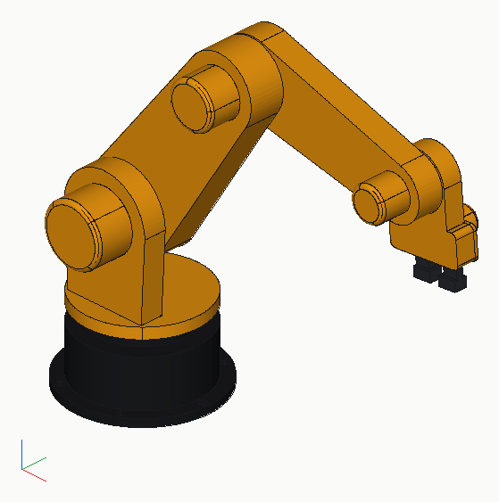
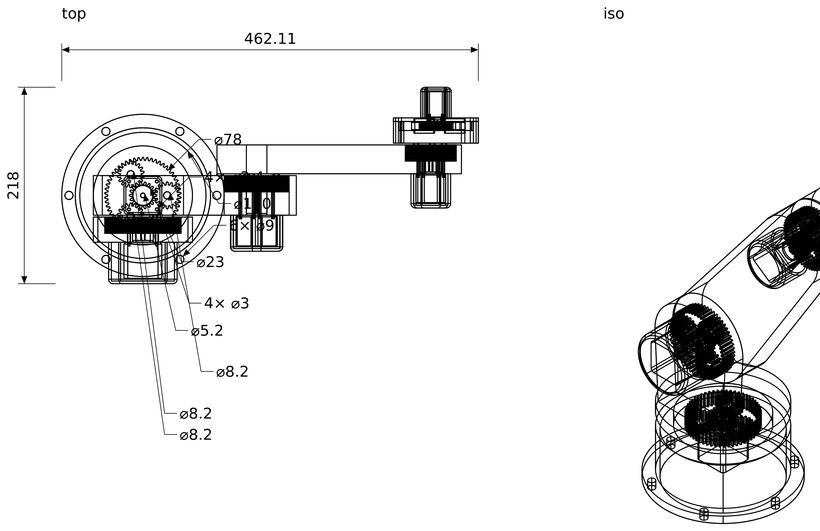
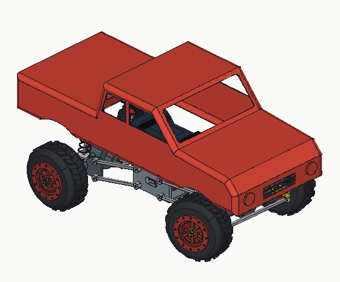
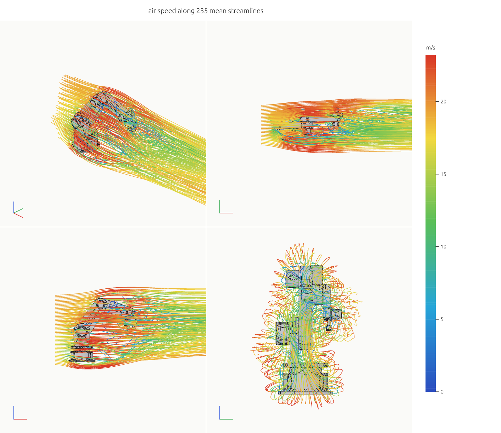
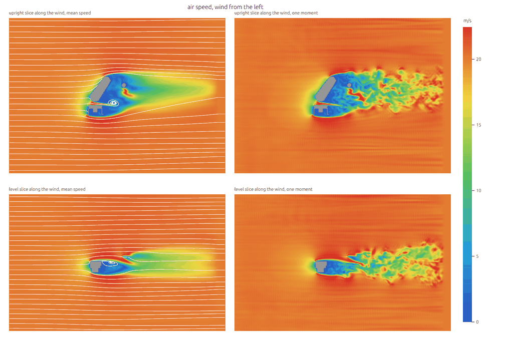

# gcad

Parametric CAD written like G-code: one operation per line, built for agents to write
and check.
It is pure Rust on the [monstertruck](https://github.com/v0l/monstertruck) B-rep
kernel and exports STEP, STL, OBJ, 3MF and SVG drawings.

Part of the [bench suite](https://github.com/v0l/bench-suite), a launcher that installs, updates
and starts it alongside the other bench tools.

```
let w=40 h=30 t=3
rect w h r=4
base: extrude t
plane base.end
mounts: hole 3.2 15,10 -15,10 -15,-10 15,-10
fillet 0.8 base.end&base.side
chamfer 0.3 mounts.side&base.end
```

## Install

```sh
curl -fsSL https://raw.githubusercontent.com/v0l/gcad/master/install.sh | sh
```

That puts the latest release in `~/.local/bin` on Linux and macOS. Windows builds are zips
on the [releases page](https://github.com/v0l/gcad/releases).

## Use

```
gcad check examples/parts/plate.gcad
gcad render examples/parts/plate.gcad plate.png
gcad export examples/parts/plate.gcad plate.step
gcad bom examples/assemblies/enclosure.gasm
gcad examples/assemblies/enclosure.gasm
gcad examples/robot/arm.gasm
gcad docs
```

Anything with more than one part is an assembly (`.gasm`): it brings the parts in
from part files, places them, joins them with turning and sliding joints and checks
that they do not overlap. A part file (`.gcad`) holds one part, or several parts as
bodies when they share sizes.

`examples/robot/arm.gasm` is a robot arm built the way industrial arms are: each
joint has a motor on its axis under a round cover, driving a planetary reducer
enclosed in the joint housing. The ring gear is cut into the housing, the sun sits on
the motor shaft, and the three planets turn on pins of the next link, which is the
reducer's output. The gripper's fingers are racks on one pinion inside its housing.
Drag the joint sliders in the viewer and every sun and planet turns at its ratio; the
explode slider and the section tool show the gears inside.




`examples/truck/truck.gasm` is a 1:10 scale crawler in 90 parts: carbon ladder rails, a
four-link solid axle at each end, coil-over shocks, an axle-mounted steering servo, a 540
motor through a spur gear and telescoping driveshafts, a battery, electronics and a hard
body. Posing the suspension swings the links while the shocks and driveshafts follow, and
posing the steering drives the drag link, both knuckles and the tie rod. Its variables pose
it; the springs are sized from `front` and `rear`, so pose the suspension through them.

```
gcad check examples/truck/truck.gasm --set front=14 --set rear=-8 --set steer=30
gcad bom examples/truck/truck.gasm
```



`examples/robot/wind.gsim` puts the arm in a 20 m/s wind. The flow is solved on the GPU
with a lattice Boltzmann solver (21 million cells in about two minutes), then the viewer
plays the streamlines back through the wake and `gcad render --flow` draws slices of the air
speed. The other simulations (torque, static, thermal, modal and buckling) are in
[docs/simulation.md](docs/simulation.md).

```
gcad sim examples/robot/wind.gsim
gcad examples/robot/wind.gsim
gcad render examples/robot/wind.gsim wind.png --flow
```

A machine without a big enough GPU can run a simulation on a paid remote worker at
[sims.gcad.sh](https://sims.gcad.sh). gcad builds the parts here, sends the built bodies (not
the project files) and writes the result beside the `.gsim` as if it had run locally.

```
gcad remote signup
gcad sim examples/robot/wind.gsim --remote
```




With no command, `gcad` opens the viewer: a live view of the file that rebuilds on
save, with a view cube, measuring, and sliders for an assembly's joints. Each part has its own
show, ghost and opacity controls, and the LINES and PARTS buttons fold away the side columns.

The format, operations and selectors are in [docs/format.md](docs/format.md), which
`gcad docs` prints. Which CAD
operations exist, which are still missing and the tests behind each are in
[docs/ops.md](docs/ops.md).

## In the browser

The viewer also runs as a WebAssembly page with an editor beside the view. Edits are kept
in the browser's local storage, and you can drop `.gcad` and `.gasm` files on the page.

```sh
./web/build.sh
python3 web/serve.py 8080
```

`./web/deploy.sh` builds it and publishes it to Cloudflare Pages at https://gcad-8oy.pages.dev.

The part after `#` in the address says what to open, so a link opens a project straight
from GitHub. The page fetches the file and every file it names (parts, includes, imports):

```
#https://github.com/v0l/gcad/blob/master/examples/robot/arm.gasm
#github.com/v0l/gcad/tree/master/examples/parts
#v0l/gcad/examples/assemblies/linkage.gasm
#examples/parts/plate.gcad
```

A `tree` link (or a bare repository) lists every part in that folder and opens the first
assembly. The address follows whatever file is open, so copy it to share the view.
Simulations and flow do not run in the browser. Models build on a pool of web workers, so
the page stays responsive: the robot arm takes about 15 s (11 s on the desktop). Threads
need a nightly toolchain with `rust-src` to build, and the page must be served with the
cross-origin isolation headers in `web/_headers` (`web/serve.py` sends them too).

## Agent skill

[skills/gcad/SKILL.md](skills/gcad/SKILL.md) teaches an agent the write, check, render loop,
the selectors, assemblies and the traps. It ships in every release archive; link the
`skills/gcad` directory into your agent's skills folder.

## Building

The kernel is a fork of [monstertruck](https://github.com/v0l/monstertruck) with fillet and
boolean fixes. `Cargo.toml` pins a commit of its `cad-regressions` branch through
`[patch.crates-io]`, so a plain build fetches it.

```sh
git clone https://github.com/v0l/gcad
cd gcad && cargo build --release
```

Push a `v*` tag to build Linux, macOS and Windows archives and publish them as a GitHub
release.

## License

GPL-3.0-or-later.
