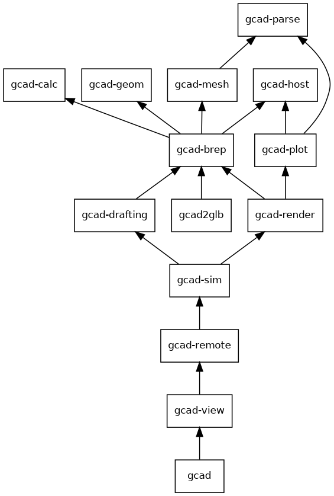

# gcad crates

gcad is a cargo workspace of small crates. Each crate has one job and depends only on the crates
below it, so a change in the viewer does not rebuild the solid language, and a game or tool can
take the parts it needs without the app.

The picture is `docs/gcad-crates.dot` (made from `cargo metadata`, transitive edges removed with
`tred`); regenerate it the same way when a crate dependency changes.

## The crates

| crate | holds | may depend on |
|---|---|---|
| `gcad-parse` | the line parser, expressions, `Scope`, `label`, `matches` | nothing in gcad |
| `gcad-calc` | the `gcad calc` standards calculators and their data tables | nothing in gcad |
| `gcad-host` | the file layer: real or in-memory files, read recording, revision snapshots (the `Snapshot` trait), run supersession, `progress` | nothing in gcad |
| `gcad-geom` | kernel helpers: bounds, meshing, 2D offsets, face and edge selectors, packed solids | monstertruck |
| `gcad-version` | `BUILD`, the version string with the last code commit | nothing |
| `gcad-plot` | simulation results (`Outcome`, `Series`, `Field`, `Movie`, `Expect`) and the charts | parse, host |
| `gcad-mesh` | meshes, sculpting, rigs, clips, the GLB writer, the C ABI. No kernel | parse |
| `gcad-brep` | the solid language: sketches, features, bodies, assemblies, mates, materials, standard parts, the part cache, `glb_of` for files with solids | parse, calc, host, geom, mesh, version |
| `gcad-drafting` | STEP, STL, OBJ, 3MF, SVG and DXF export, drawings, `.gdwg` sheets, nesting, BOM | brep, geom, host, mesh, parse |
| `gcad-render` | the software renderer (`gcad render`) and `gcad inspect` | brep, geom, mesh, plot |
| `gcad-sim` | the `.gsim` language, every solver, flow, packed jobs; `gcad_sim::model` and `gcad_sim::drafting` wrap brep and drafting so a `.gsim` opens anywhere | brep, drafting, render, plot, geom, host, parse, version, the sims crates |
| `gcad-remote` | the paid remote simulation client and worker (not on wasm) | brep, sim |
| `gcad-view` | the egui and wgpu viewer, the egui host helpers (`wake`, `show_revision`), and the `game-assets` pipeline | everything above |
| `gcad2glb` | the runtime library a game links (`Assets::from_source`/`from_path`: meshes, and with `brep` solids and assemblies, as one `gcad_mesh::Model`) and the `gcad2glb` command over it, see [gcad2glb.md](gcad2glb.md) | mesh, version; brep with the `brep` feature (on for the command, off with `default-features = false`) |
| `gcad` | the CLI and the facade library that keeps every old path (`gcad::model`, `gcad::sim`, `gcad::export`, ...) | everything; `gcad-view` only with the default `view` feature |
| `gcad-web`, `gcad-mesh-viewer`, `gcad-sims-proto` | unchanged | |

What was planned and not made, and why:

- No `gcad-asm`. Assemblies, mates, constraints and the rig are fields and methods of `Model`
  (`apply` hands assembly lines to them, `run_model` prefetches parts), so they stay in gcad-brep.
- No separate `gcad-export`. `drawing` takes `export::Colour` and `export` writes drawings and
  parts lists, so they live together in gcad-drafting.
- `src/asset` (game assets) did not become `gcad-assets`. It reads the viewer (`view::asset`)
  in its tests and the viewer reads it everywhere, so it sits in gcad-view behind the
  `game-assets` feature.
- The runtime library is `gcad2glb` itself (lib and bin in one package), not a new
  `gcad-assets` or `gcad-runtime`: that is the name it is known by, nothing else uses it, and
  `gcad-assets` would read as the `game-assets` pipeline above.

## Where new code goes

- A new operation of the solid language: gcad-brep. Mesh-body operations: gcad-mesh.
- A new simulation kind or `.gsim` line: gcad-sim (`language.rs` for the line, its own module for the solver).
- A new export format or drawing feature: gcad-drafting.
- Anything with egui, wgpu or the window: gcad-view.
- A new CLI command: `src/main.rs`, calling into the crate that does the work.
- Helpers that two crates need go down to the lowest crate both already depend on (that is why
  `label` and `matches` live in gcad-parse).

Rules that keep the graph honest: gcad-mesh never takes the kernel; gcad-brep never takes sims,
egui or wgpu (`.gsim` support is a hook, `model::set_study`, that gcad-sim installs);
`cargo build -p gcad --no-default-features` has no egui or wgpu. Check with
`cargo tree -p <crate> -e normal | grep -E "egui|wgpu|sims-"`.

## Timings and sizes

Linux x86_64, 48 cores, `CARGO_BUILD_JOBS=6`, `nice -n 15`, release. Before is master f541e8e
(one big `gcad` crate), after is the split.

| build | before | after |
|---|---|---|
| clean `cargo build --release --workspace` | 125 s | 116 s |
| touch the solid language (`src/model/mod.rs`, now gcad-brep) | 28.2 s | 22.1 s |
| touch a simulation file (`src/sim/mod.rs`, now gcad-sim) | 30.9 s | 11.0 s |
| touch the viewer (`src/view/mod.rs`, now gcad-view) | 28.8 s | 5.8 s |
| touch `src/main.rs` | | 1.8 s |
| touch the calculators | 29.9 s | 22.5 s |
| touch the parser (`gcad-mesh/src/parse.rs`, now gcad-parse) | 36.3 s | 26.0 s |
| `cargo test --release --workspace`, build and run | 472 s (60 s of it a git signing timeout) | 260 s |

The slowest crate in a clean build was `gcad` at 27.5 s; it is now gcad-brep at 44.6 s, with
gcad-sim at 19.2 s building beside the viewer's dependencies.

| binary | size |
|---|---|
| `gcad`, default (viewer) | 61.2 MB before, 66.0 MB after |
| `gcad --no-default-features` (CLI without the viewer) | 43.8 MB, no egui or wgpu in its tree |
| `gcad --features game-assets` | 65.6 MB before, 70.9 MB after |
| `gcad2glb --no-default-features` (meshes only) | 2.09 MB (1.65 MB stripped), 11 crates |
| `gcad2glb` (meshes and solids) | 18.9 MB (13.6 MB stripped), no egui, wgpu or solvers |
| a game binary linking the `gcad2glb` library, meshes only / with `brep` | +1.41 MB / +18.3 MB (+1.06 / +13.0 MB stripped), clean build 5.9 s / 42.4 s |
| web `gcad_web.wasm` (before wasm-opt) | 30.42 MB before and after |

The default `gcad` binary grew by about 5 MB (3 MB stripped): code now crosses crate boundaries
and is inlined less. No third-party dependency was added. The lock file lost `npyz`, `pest`,
`rand` and `stacker`: the old root manifest turned on faer's default features (`npy`, `rand`),
which nothing uses; gcad-sim asks for `std`, `sparse-linalg` and `rayon` only, and every output
hash stayed the same.

Every stage kept `tests/baseline` identical: the bytes of every CLI output over `examples/` and
`tests/fixtures` (both builds) and the test counts. See `tests/baseline/README.md`.

## For contributors

- Paths inside crates did not change: moved files keep `crate::model`, `crate::sim`, ... through
  aliases at the top of each crate's `lib.rs`. `gcad::...` paths for tests and tools are the same as
  before, except `model.sim` (now `Option<Box<dyn Study>>`): read a simulation with
  `gcad::sim::spec(&model)`.
- Tests that need the repo root use `concat!(env!("CARGO_MANIFEST_DIR"), "/../..")` inside crates.
- Integration tests stay in `tests/` (docs/ops.md lists them and `tests/ops_doc.rs` reads them there).
- `gcad-version` and the root `build.rs` both hash `src crates sims-proto Cargo.* build.rs` into
  the version string; keep the two lists the same.

## For the game-assets fork

The `game-assets` feature is unchanged on the command line: `cargo build --features game-assets`.
Its code moved from `src/asset/` and `src/view/asset_*` to `crates/gcad-view/src/asset/` and
`crates/gcad-view/src/view/asset_*`; `gcad::asset` still names it. The feature now lives on
`gcad-view` (with `xatlas-rs-v2`), and the root `game-assets` feature turns it on together with
`gcad-brep/game-assets` (for `model::run_path_recorded`). Run `sh tools/game-assets.sh
prepare-fixtures` before `cargo test --features game-assets`, as before.
