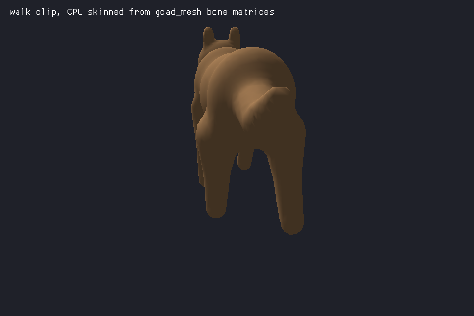
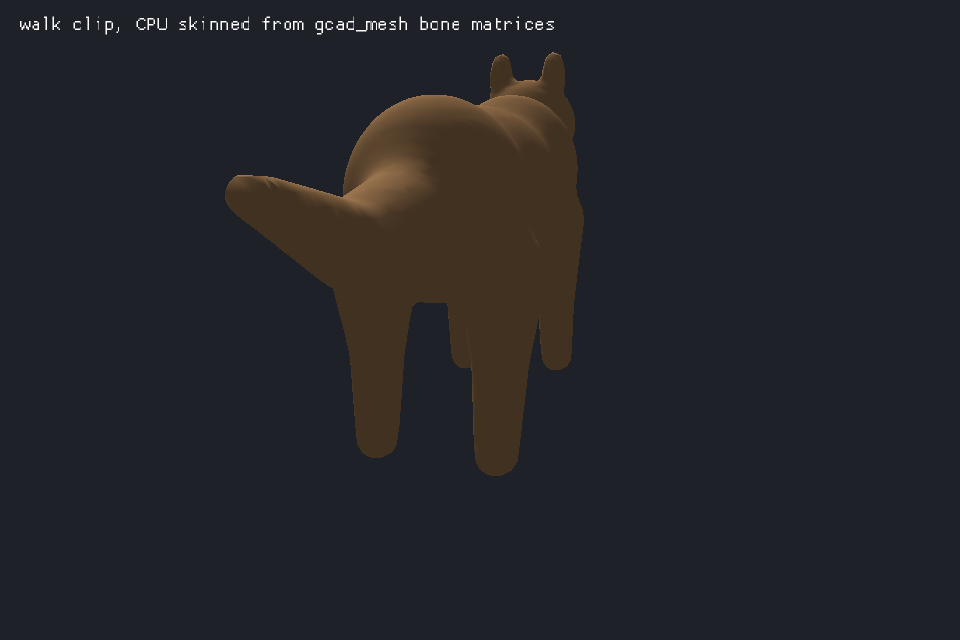
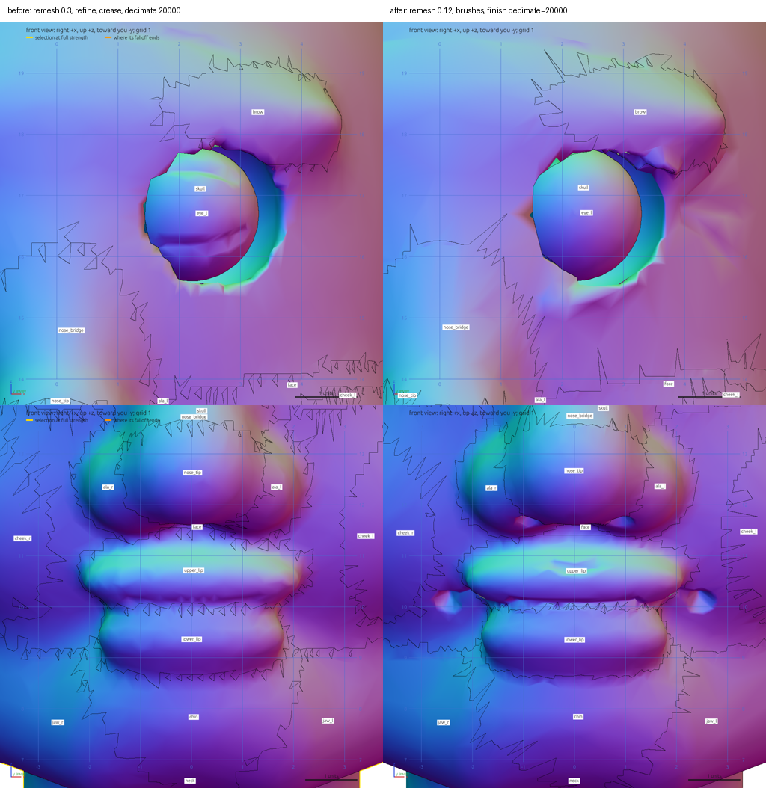
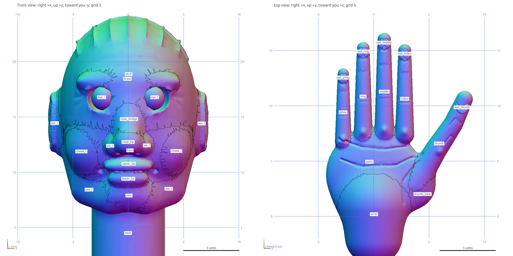

# gcad-mesh: build models from gcad text at startup

`crates/gcad-mesh` is the mesh and rig half of gcad as a small library. It runs the mesh operations
(`blob`, `limb`, `remesh`, `select` and the sculpt ops, `bone`, `skin`, `pose`, `clip`, `key`, plus
`let`, `if`, `body`, `move`, `rotate`, `scale`, `mirror`, `color`) with no CAD kernel, egui, wgpu or
sims. The main `gcad` crate uses the same code, so there is one implementation. The `.gcad` text ships
in the game (a few KB) and the model is built when the game starts, or at build time into a GLB.

Dependencies: `anyhow` and `serde_json` (rayon only with the `parallel` feature). No global state, no
threads unless `parallel` is on, same text gives the same bytes.

## Rust API

```rust
const HERO: &str = include_str!("hero.gcad");

let model = gcad_mesh::build(HERO)?;
let body = &model.bodies[0];
// body.positions, normals, colours (per vertex, f32), indices (u32, grouped by part)
// body.parts: name, colour, gloss, first_index, index_count (one draw call each)
// body.joints, joint_indices, joint_weights (4 influences), body.clips (keyframes)
let walk = body.clip_index("walk");
let matrices = body.bone_matrices(walk, t);
let skinned = body.skinned_positions(&matrices);
let glb: Vec<u8> = model.to_glb()?;
```

`bone_matrices(clip, t)` returns one column-major 4x4 matrix per joint that moves a rest-pose vertex to
the posed one, so an engine can upload them and skin on the GPU with `joint_indices` and
`joint_weights`. `None` for the clip gives the rest pose. `skinned_positions` is the CPU version.
Coordinates are Y up like the GLB; `Options { y_up: false, .. }` keeps gcad's Z up.

`build_with(source, &Options)` takes `detail` (cell size multiplier, 1 is the file's own resolution,
2 halves the grid on each axis) and `vars` (override `let` values). Errors are `gcad_mesh::Error` with
`line`, `text` and `message`; a line outside the mesh subset (`rect`, `extrude`, ...) fails with its
line number instead of being run.

`gcad_mesh::to_glb(&str)` is `build(..)?.to_glb()`. The GLB equals `gcad export f.gcad f.glb` byte for
byte for `creature`, `fox` and `rigged_creature` (tests in `tests/gcad2glb.rs`).

## C ABI

`crates/gcad-mesh/include/gcad_mesh.h`, linked from `libgcad_mesh.a` or `libgcad_mesh.so`. `gcad_build`
returns a handle that is always non-null; `gcad_error` is null on success, else the line numbered
message. Buffer getters return pointers owned by the handle, valid until `gcad_free`.
`gcad_bone_matrices(model, body, clip, t, out, capacity)` fills `joints * 16` floats (clip -1 is the
rest pose) and returns the joint count, also when `out` is null. `gcad_glb` returns bytes released with
`gcad_glb_free`. `crates/gcad-mesh/tests/c_abi.c` is built and run from `tests/c_abi.rs`.

## Command line

```
gcad2glb [--detail N] [--z-up] [--tris N] [--max-error E] in.gcad out.glb
```

`--tris` and `--max-error` decimate every unskinned body before writing it, like a `finish` line at
the end of each body (`gcad export f.gcad f.glb --tris N` gives the same bytes). Skinned bodies keep
their triangles: put `finish` before `skin` in the file instead.

A `build.rs` step for a game:

```rust
fn main() {
    let spec = std::fs::read_to_string("art/hero.gcad").unwrap();
    let glb = gcad_mesh::to_glb(&spec).unwrap();
    let out = std::path::PathBuf::from(std::env::var("OUT_DIR").unwrap());
    std::fs::write(out.join("hero.glb"), glb).unwrap();
    println!("cargo:rerun-if-changed=art/hero.gcad");
}
```

On device, call `build` at load and upload the buffers directly. wasm32, iOS and Android targets build
(`cargo build -p gcad-mesh --lib --target wasm32-unknown-unknown`); for Android and iOS use the
`staticlib` or `cdylib` with the C header. `crates/gcad-mesh-viewer` is a macroquad example that builds
`rigged_creature.gcad` at startup and plays the `walk` clip.

## Measured

Linux x86_64, release, one run each, cold start of the process.

| thing | value |
|---|---|
| `gcad2glb` binary | 1.24 MB (1.42 MB with `parallel`) |
| `gcad-mesh` wasm32 library | 674 KB, 223 KB gzipped |
| `libgcad_mesh.so` aarch64-linux-android (cargo-ndk, NDK 28, release) | 1.22 MB |
| `libgcad_mesh.dylib` aarch64-apple-ios (release, built on the M1) | 1.02 MB |
| `libgcad_mesh.a` android / ios | 26.9 MB / 20.1 MB (unstripped archives, the linker keeps only what is used) |
| `gcad2glb` on the M1 (aarch64-apple-darwin) | 1.11 MB, `rigged_creature` in 0.44 s wall, GLB byte-identical to the Linux build |
| crates built for `gcad-mesh` | 7 including itself |
| release build of the crate with dependencies cached | 1.4 s |
| `rigged_creature.gcad` to GLB | 1814 B to 477700 B, 65 ms (16 ms `parallel`, 13 ms at `--detail 2`, 124440 B) |
| `creature.gcad` to GLB | 513 B to 1274984 B, 243 ms |
| `fox.gcad` to GLB | 3564 B to 14948800 B, 5.8 s |
| kids-free-games `art/3d/hero/hero.gcad` to GLB | 12885 B to 471644 B, 474 ms |

Khronos glTF-validator reports 0 errors and 0 warnings for `rigged_creature` and the hero, and three.js
loads `rigged_creature` with its two clips and 14 bones (`tools/gltf`).

The hero GLB in `kids-free-games/assets/models/hero.glb` is 471748 B, so shipping the 12885 B text and
building at load saves 97 percent of the asset bytes.

`tools/gltf/load.mjs GLB clip t expected.json` loads a GLB in three.js, poses it at the clip time and
compares sampled skinned vertices with `cargo run -p gcad-mesh --example dump_skinned`. On
`rigged_creature` walk at 0.37 s, 2160 vertices differ by at most 3.9e-6 (rest displacement up to 2.1).




`crates/gcad-mesh-viewer` running in a headless sway: the creature is built from `rigged_creature.gcad`
at startup (66 ms) and the walk clip is skinned on the CPU every frame.

## Sculpting dense meshes

`cargo run --release --features parallel -p gcad-mesh --example sculpt_timing -- LEVELS` sculpts a
r=10 ball meshed at 0.1 and subdivided LEVELS times. Linux x86_64, 48 threads, one run each.

| op | 1.5M triangles (`subdivide 1`) | 6.0M triangles (`subdivide 2`) |
|---|---|---|
| `subdivide` | 138 ms | 1134 ms |
| `dab` draw, size 1 | 256 ms | 1220 ms |
| `stroke` clay, size 2, 10 long | 290 ms | 1418 ms |
| `stroke` dam_standard, size 0.3, 10 long | 404 ms | 1982 ms |
| `dab` smooth, size 1.5 | 440 ms | 2337 ms |
| `stroke` move, size 3 | 258 ms | 1195 ms |
| `mask sphere=`, `select all`, `inflate` | 5, 5, 19 ms | 20, 20, 84 ms |
| `finish decimate=20000` | 13.0 s, 0.011 off at most | 60.8 s, 0.021 off at most |

A brush only visits the vertices under it through a spatial grid, but each stroke still rebuilds the
grid, the normals and the closest-point index of the whole mesh, which is most of its time. `finish`
runs once at the end; `finish max_error=` decimates several times to find the count, so it costs a few
times more.

## Fine detail at a game budget

An agent that had only the gcad skill sculpted a head (498k triangles while sculpting) and a hand
(119k), each finished with `finish decimate=20000`; the surface moved at most 0.2% and 0.07% of
their size. The same head blocked out the old way (`remesh 0.3`, `refine`, `crease`,
`decimate 20000`) is on the left, the brush version on the right, both at 20000 triangles:





`examples/mesh/hero.gcad` is the kids-free-games hero rebuilt this way: 436k triangles of brush
work (mouth, lips, dimples, pores, brow, cap stitches, hair strands on a layer, sleeve and knee
folds) finished to 14000 with `focus=` on the face, then rigged.

## Normal map and LODs

`bake normals size=1024` unwraps the finished mesh into charts (faces within 60 degrees of a seed
normal), packs them in shelves, and writes a tangent-space normal map of the full-detail sculpt
(the mesh before `finish`) into the GLB, with `TEXCOORD_0` and `TANGENT`. `lod 8000 3000 1000`
(or `lod 40% 10%`, shares of the full-detail mesh) writes `NAME_LOD1`, `NAME_LOD2` meshes and links
them with `MSFT_lod` on the body's node. `finish keep=creases crease=40` and `keep=uv`
add boundary quadrics on creased edges and chart borders, `keep=colours` on colour borders.

## Flat solid profiles

gcad-mesh also runs a kernel-free subset for crisp props: `plane XY|XZ|YZ offset=`, `rect w h at= r=`, `circle d at=`, `poly x,y ...`, `array count= step=` (or `angle=`), `extrude d` (negative goes the other way), `repeat label count= step=` and `fillet r label.end&label.side` (or `.start`). A profile inside another is a hole. Fillets are four bevel rings. Each `body` holds its own extrusions; there are no booleans between them.
