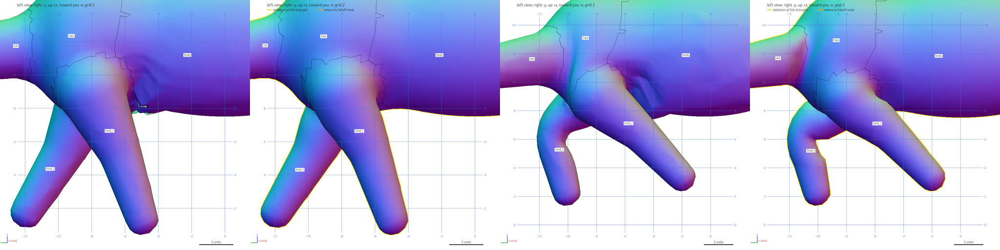
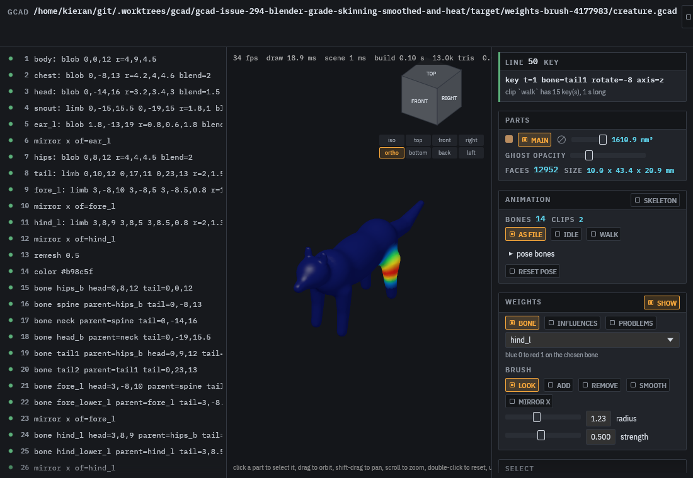
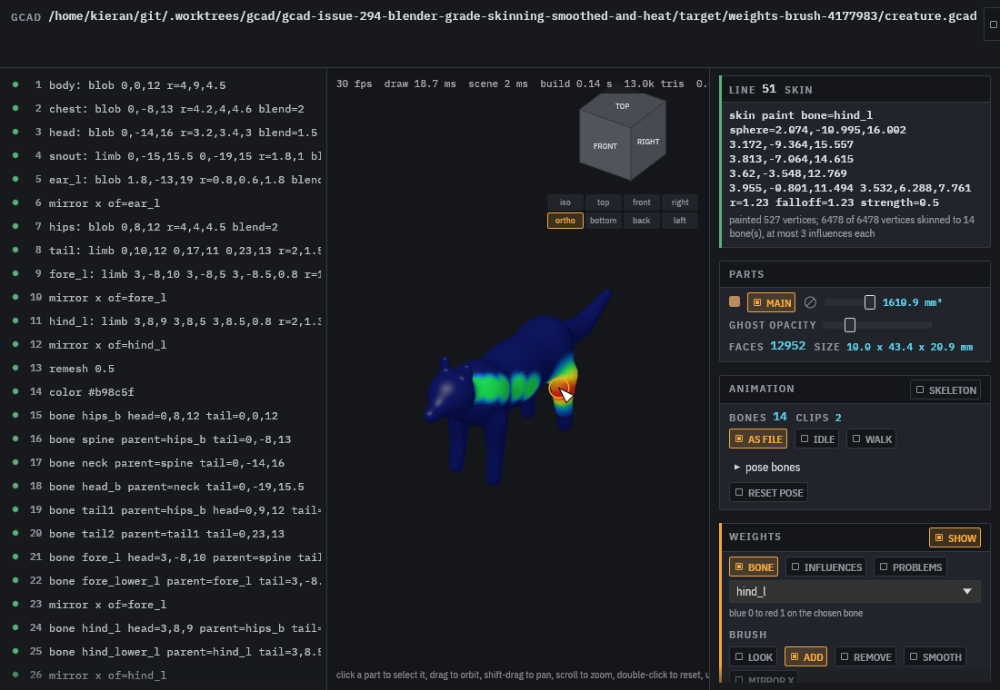
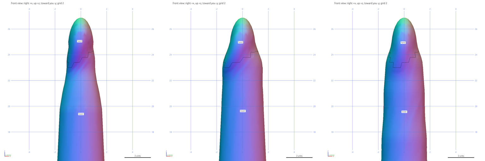
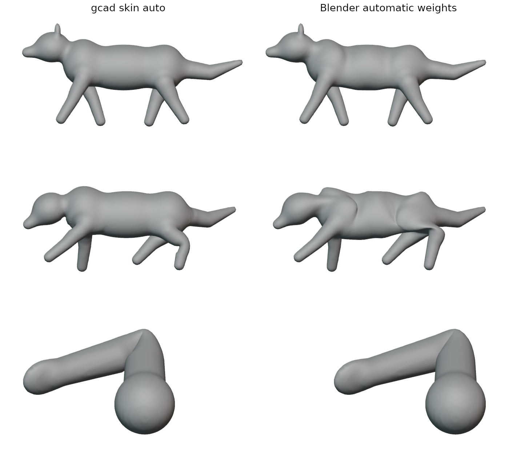

# Skinning

How gcad binds a mesh to its bones, what makes a skin good, and the numbers that check it.



## Bounds

The fixture tests (`crates/gcad-mesh/tests/skinning.rs`) hold `skin auto` to these, against the old
distance weights:

| | old, creature / stress | now, creature / stress | bound in the tests |
|---|---|---|---|
| largest weight step across an edge | 1.00 / 0.81 | 0.27 / 0.28 | under 0.35, no edge over |
| vertices on an unrelated bone | 1084 / 1122 | 0 / 0 | 0 |
| rigid core, worst bone | 0.00 / 0.00 | 1.00 / 1.00 | 0.99 or more |
| flipped triangles over the clips | 198 / 103 | 0 / 3 | 0 / 4 or fewer |
| squashed triangles | 14 / 23 | 0 / 7 | 0 / 8 or fewer |
| stretched triangles | 141 / 82 | 0 / 0 | 0 on the creature |
| slivers in joint zones | 40 / 37 | 0 / 1 | 2 / 4 or fewer |

The arm (`skin_arm`): no step over 0.35, rigid cores 1.00, and its twisted wrist 15% wider or more with
`twist=` or `skin blend dq=`. Its 120 degree elbow still flips 28 triangles under linear skinning
(Blender's weights: 88); that needs corrective shapes, #300.

## Workflow

1. Sculpt and `remesh` first, then `relax 6` to even the triangles; `skin` binds the vertices that exist.
2. `bone` lines, `mirror x of=` for the other side, then `skin auto` (bone heat).
3. `gcad skincheck f.gcad`. Aim for no edge over 0.35, 0 unrelated, rigid cores near 1 and no
   flipped triangles over the clips. Write a `clip` with the extreme poses the game will play
   (a range-of-motion clip) so the check sees them.
4. Open the file in the viewer (`gcad f.gcad`), turn on the weights card: `bone` shows one bone's
   weight from blue 0 to red 1, `influences` how many bones each vertex has, `problems` the vertices
   behind steep edges, loose cores and flips.
5. Fix joints with the brush: `add` and `remove` paint toward or away from the chosen bone,
   `smooth` evens the weights out, `mirror x` paints the partner bone on the other side. Each
   drag appends one `skin paint` or `skin smooth` line to the file, so the edit is text, stays
   reproducible and shows up in the diff. Shift-drag still pans.
6. `skin mirror` copies a finished side across; `skin normalize` cleans up after hand edits.

 

## Limits

- GLB consumers run linear blend skinning with 4 joints per vertex, so the weights have to look
  right under LBS; that is what `skincheck` measures.
- Sharp bends (the 120 degree elbow of `skin_arm`) still fold under LBS. `twist=` segments and
  `skin blend dq=` fix twists; corrective shapes for bends are #300. `refine joints` adds rings at the joints before binding.
- Weights are stored as the `skin` lines that made them. There is no binary weights file. For a
  compact game export, use the mesh body as a `.gasset` `source`: its skin goes through the palette
  prune and UNORM16 weight quantise (`examples/game-assets/creature.gasset`).

## Checking a skin

`gcad skincheck file.gcad` prints, for every skinned body:

| number | what it measures | good |
|---|---|---|
| weight jump | the largest change of any bone's weight across one mesh edge (max and 99th percentile), and how many edges change by more than 0.35 | no edge over 0.35 |
| contested | vertices whose two strongest bones are within 10% of each other | only in joint zones |
| influences | how many vertices have 0, 1, 2, 3 and 4 bones | at most 4, none with 0 |
| unrelated | vertices that take at least 5% from a bone that is not their strongest bone, its parent or its child | 0 |
| rigid core | for the middle 50% of each bone, at least 2 limb thicknesses from a joint and not closer than twice to an unrelated bone, the share of vertices nearest that bone that are 99% or more on it | near 1 |
| slivers in joint zones | triangles touching blended vertices whose longest edge squared is over 6 times twice their area | few; `relax 6` after `remesh` |
| posed quality | every clip pose at its keys and halfway between: the smallest and largest triangle area ratio against rest, the worst growth of the aspect ratio, and how many triangles flip against their leading bone's turn, shrink below a quarter or grow past four times | no flips |

`tools/skin_shots.sh OUT` renders the fixtures at their worst keys with `gcad inspect` (set `GCAD` to the
binary to use).

## Fixtures

- `examples/mesh/rigged_creature.gcad`: the quadruped with a tail, `walk` and `idle` clips.
- `examples/mesh/skin_stress.gcad`: the same quadruped with the legs 0.4 closer, so the crotch is narrow,
  and a `rom` clip with the legs at 50 degrees, the knee at 70, the tail at 35 and the neck at 25.
- `examples/mesh/skin_arm.gcad`: a two-bone arm and a hand, bent 120 degrees at the elbow, swung 60 at
  the shoulder, and the hand twisted 90.

## Stage 4: twist segments and dual quaternion blending

`bone lower parent=upper tail=0,0,23 twist=3` makes the bone three segments (`lower`, `lower_twist1`,
`lower_twist2`; with an `_l`/`_r` ending the side stays last, `fore_twist1_l`). The roll of the next bone
about the limb axis is shared between the segments, so the forearm turns over its length instead of at
the wrist. The GLB gets the segment rotations baked into every clip at its frame rate, so any player
shows it with plain LBS. A child given `parent=lower` hangs from the last segment.

`skin blend dq=1` poses with dual quaternion skinning (`dq=0.5` blends it half and half with linear,
like Blender's DQ blend). It keeps volume in twists and bulges at sharp bends. It changes what gcad
shows (`pose`, `render`, `inspect`, the viewer, OBJ export, `skincheck`), not the GLB: GLB players skin
linearly, so the weights must already look right without it.



| arm, wrist turned 90 degrees | narrowest radius at the wrist (rest about 1.6) |
|---|---|
| linear blend | 1.07 |
| `skin blend dq=1` | 1.51 |
| `twist=3` on the forearm | 1.46 |

(`tests/skinning.rs` holds both at 15% over linear or more.) With `twist=3` the arm's elbow flips rise
from 28 to 56: the first segment is a third as long, so its joint zone is shorter. Corrective shapes
for sharp bends are #300.

## Stage 5: slivers in joint zones

`gcad skincheck` counts triangles in blended zones (any corner with more than one bone) whose longest
edge squared is over 6 times twice their area. Thin triangles where weights blend are the ones that
fold first. `relax 6` straight after `remesh` evens them out:

| fixture | slivers, `remesh` only | after `relax 6` | flips after |
|---|---|---|---|
| rigged_creature | 40 of 10286 | 0 of 10227 | 0 (was 4) |
| skin_stress | 37 of 9999 | 1 of 10011 | 3 (was 6) |
| skin_arm | 8 of 2512 | 0 of 2499 | 30 (was 28) |

Both quadruped fixtures now have the `relax 6` line. A remesh that adds edge loops at joints is #302.

## Against Blender

Blender 4.2.23 (the portable Linux build, run headless) gave each fixture "Parent with automatic
weights" (bone heat) on the same welded mesh and armature, exported from gcad as GLB.
`tools/blender/auto_weights.py` writes Blender's weights, `tools/blender/side_by_side.py` renders both
in Blender with its own linear skinning, and `crates/gcad-mesh/tests/blender.rs` (ignored, run with
`BLENDER_WEIGHTS=dir`) scores Blender's weights with `skincheck`:

```sh
blender -b --factory-startup --python tools/blender/auto_weights.py -- creature.glb creature.json
BLENDER_WEIGHTS=dir cargo test -p gcad-mesh --release --test blender -- --ignored --nocapture
```

| fixture | weights | max jump | unrelated | min core | area ratio | aspect growth | flipped | squashed | stretched |
|---|---|---|---|---|---|---|---|---|---|
| rigged_creature | Blender | 0.307 | 2651 | 1.00 | 0.463..2.29 | 3.99 | 0 | 0 | 0 |
| rigged_creature | gcad | 0.271 | 0 | 1.00 | 0.645..1.47 | 1.63 | 0 | 0 | 0 |
| skin_stress | Blender | 0.310 | 2658 | 1.00 | 0.022..6.51 | 80.0 | 286 | 153 | 8 |
| skin_stress | gcad | 0.277 | 0 | 1.00 | 0.090..2.42 | 13.0 | 3 | 7 | 0 |
| skin_arm | Blender | 0.209 | 0 | 1.00 | 0.019..2.19 | 19.9 | 88 | 92 | 0 |
| skin_arm | gcad | 0.138 | 0 | 1.00 | 0.012..2.09 | 15.5 | 28 | 78 | 0 |



Left gcad, right Blender, both posed by Blender: the creature's walk, the stress quadruped at its
worst key, and the arm at 120 degrees. Blender gives 2651 creature vertices weight from a bone that is
not the vertex's leading bone, its parent or child; gcad gives none. In the stress pose that shows as
creases over the back and shoulders. Neither side was hand-fixed.

## Before (straight-line distance, `power=4`)

| fixture | max jump | p99 | edges over 0.35 | contested | unrelated | min core | area ratio | aspect growth | flipped | squashed | stretched |
|---|---|---|---|---|---|---|---|---|---|---|---|
| rigged_creature | 1.000 | 0.377 | 198 | 852 | 1084 | 0.00 | 0.056..90.8 | 28.3 | 198 | 14 | 141 |
| skin_stress | 0.813 | 0.271 | 107 | 794 | 1122 | 0.00 | 0.055..12.8 | 24.2 | 103 | 23 | 82 |
| skin_arm | 0.152 | 0.099 | 0 | 140 | 0 | 0.00 | 0.155..1.60 | 3.81 | 0 | 166 | 0 |

The creature's hind legs and crotch fold into spikes in the walk because neighbouring vertices pick
different leading bones, and no bone has a rigid core: every vertex blends four bones by distance.

## Stage 1: smoothed weights (`skin auto method=smooth`)

1. Each vertex starts from the distance weights, limited to its nearest bone, that bone's parent and
   its children.
2. Vertices in the middle of a bone (`core`, and `joint` thicknesses away from either end) and clear of
   any unrelated bone are pinned to it at 1.
3. Pins of unrelated bones closer than a quarter of a bone (or five edges) along the surface are
   dropped, so the crotch and armpit stay free.
4. The free weights are smoothed over the mesh edges (Gauss-Seidel, 300 passes); after each step any
   weight shared by two unrelated bones moves to the bone that links them, so the left and right leg
   never share a vertex.
5. Where an edge still steps by more than 0.28, the pins next to it are released and the area smoothed
   again, up to 30 rounds.
6. At most 4 bones are kept, weights under 0.01 dropped, the rest summing to 1.

| fixture | max jump | p99 | edges over 0.35 | contested | unrelated | min core | area ratio | aspect growth | flipped | squashed | stretched |
|---|---|---|---|---|---|---|---|---|---|---|---|
| rigged_creature | 0.263 | 0.175 | 0 | 273 | 0 | 0.88 | 0.508..8.01 | 1.95 | 6 | 0 | 6 |
| skin_stress | 0.268 | 0.179 | 0 | 276 | 0 | 0.85 | 0.081..3.18 | 9.36 | 5 | 9 | 0 |
| skin_arm | 0.151 | 0.081 | 0 | 67 | 0 | 1.00 | 0.006..5.09 | 53.1 | 13 | 156 | 2 |

Both quadrupeds are better on every number. The remaining flips on the creature are in the armpit,
where the shoulder folds into the chest. The arm is worse at the 120 degree elbow than the distance
weights (13 flips against 0) because its blend zone is narrower; that is the plain LBS elbow collapse
that bone heat weights (stage 2) and dual quaternion or twist bones (stage 4) address. The arm's
156 squashed triangles are the 90 degree wrist twist: a candy wrapper that needs twist bones.

`tests/skinning.rs` in `crates/gcad-mesh` holds these bounds: no edge over 0.35, no unrelated weights,
rigid cores at 0.85 or more, flips at most 8 on the quadrupeds.

On a 186k-triangle quadruped (93k vertices, 13 bones) `skin auto method=smooth` takes 2.5 s in a release build.

## Stage 2: bone heat (`skin auto`, the default now)

The method of Baran and Popovic (2007), which Blender's "automatic weights" uses. For each bone `b`,
solve on the surface

```
(L + H) w_b = H p_b
```

where `L` is the cotangent Laplacian of the mesh, `H` is diagonal with `H_v = heat * area_v / d_v^2`
(`d_v` the distance from vertex `v` to its nearest bone it can reach through the inside of the mesh),
and `p_b` is 1 where `b` is that nearest bone (split evenly on a tie). Heat flows along the surface,
so the other leg across the crotch gets nothing unless the surface joins them. The weights for all
bones are solved together as one block conjugate gradient (Jacobi preconditioned, started from the
distance weights, relative tolerance 1e-3) in `crates/gcad-mesh/src/mesh/skin_heat.rs`; no new
dependencies, and it builds for wasm32.

After the solve: weights shared by two unrelated bones move to the bone that links them, weights under
`cut` (0.05) are dropped and the rest stretched back to 0..1, the middle of each bone snaps to 100%
where heat already gives it 80%, and the steps that leaves are smoothed away as in stage 1.

| fixture | max jump | p99 | edges over 0.35 | contested | unrelated | min core | area ratio | aspect growth | flipped | squashed | stretched |
|---|---|---|---|---|---|---|---|---|---|---|---|
| rigged_creature | 0.278 | 0.210 | 0 | 196 | 0 | 1.00 | 0.567..7.69 | 1.72 | 4 | 0 | 6 |
| skin_stress | 0.279 | 0.219 | 0 | 196 | 0 | 1.00 | 0.159..3.41 | 6.41 | 6 | 7 | 0 |
| skin_arm | 0.138 | 0.120 | 0 | 32 | 0 | 1.00 | 0.012..2.09 | 15.5 | 28 | 78 | 0 |

Against stage 1, every bone has a full rigid core, contested vertices drop by a quarter on the
quadrupeds, the stress knee no longer creases inward, and the arm's squashed wrist and stretched
elbow halve. The arm's flips go up (13 to 28): the 120 degree elbow fold now collapses over a wider,
smoother band, the plain LBS limit that twist bones and dual quaternion skinning (stage 4) address.

Time for `gcad check` on the 186k-triangle quadruped, remesh included: 2.3 s with heat, 1.1 s with
`smooth` (the inside-reach test and the SpMV run in parallel). `gcad2glb`, built without the
`parallel` feature, takes 4.9 s for the same file: 1.7 s for the reach test, 1.8 s for the solve.
