# Training data for a gcad inverse-modelling model

Source data for a model that rebuilds a 3D object as gcad ops from a render or a concept image. This
step only gathers, licenses and catalogues. Reference renders, the shape-distance score, synthetic
concept pairs and training are separate issues.

Nothing here is committed to git except the scripts and the contact sheets. The data lives in
`/home/kieran/gcad-datasets` on `/` (never `/mnt/data`, which filled up and took down vLLM).

## Layout and rebuild

```
$GCAD_DATA (default /home/kieran/gcad-datasets)
  raw/<source>/            downloads, originals kept
  out/<source>/glb/        every mesh normalised to GLB
  out/<source>/manifest.jsonl, dropped.jsonl
  out/manifest.jsonl       all sources merged (157372 lines)
  out/dropped.jsonl        every dropped file with the reason (151 lines)
  out/summary.json         per-source counts used for the tables below
```

Rebuild: create a venv with `trimesh numpy pillow requests huggingface_hub pyarrow scipy networkx
matplotlib cadquery`, unpack Blender 4.2.3 into `$GCAD_DATA/tools/`, then:

```
tools/datasets/run.sh fusion360 pix3d abo gso thingi10k polyhaven objaverse
```

`run.sh` runs at most 2 scripts at once under `nice -n 19 ionice -c3`, and every worker pool is capped at 8.
Each script takes step names (`download`, `normalise`, plus `metadata` and `select` where a subset is
chosen). `check_space` in `tools/datasets/common.py` refuses to run on `/mnt/data`, keeps 100 GB free, and stops
before the 300 GB budget. Downloads resume from `.part` files or `aria2c -c`, and verify md5 where the source gives
one (Poly Haven). `aggregate.py` builds the merged manifest and `contact_sheet.py` the sheets.

## Normalisation

- Every mesh becomes a GLB (`trimesh`, or Blender for `.blend`); the original stays in `raw/`.
- Per mesh: bounding box, triangle count, connected part count, watertight (after vertex merge).
- CAD build steps stay in their native format beside the mesh: CadQuery `program.py` plus `ops.json`
  (Zero-to-CAD, CAD-Recode), Fusion 360 reconstruction JSON, DeepCAD JSON, and STEP where shipped.
- Concept images and photos are saved as PNG.
- Broken, empty or non-finite meshes are dropped and logged with a reason in `dropped.jsonl`.

## Manifest fields

One line per object in `out/manifest.jsonl`: `id`, `source`, `url`, `license` (SPDX id, or `LicenseRef-*`),
`commercial_ok`, `attribution`, `category`, `paths` (`glb`, `original`, `step`, `build_history`, `concept`,
`photo`), `has_concept`, `has_build_history`, `has_photo`, `triangles`, `watertight`, plus `parts`,
`bbox_min`, `bbox_max`, `gcad_fit`, `gcad_fit_score`, `shape_kind`. DeepCAD has no mesh, so its
`triangles` and `watertight` are null.

## gcad fit label

A cheap rule so later steps can pick realistic targets first. It uses triangle count, connected part
count and whether the shape is mechanical or organic.

- Mechanical if it comes from a CAD source, or at least 45% of the surface area faces along an axis
  (normal component above 0.99), or its category is a known hard-surface one (furniture, vehicle, tool,
  container, building and similar). Otherwise organic.
- Triangle factor: up to 1500 gives 1.0, up to 10k 0.75, up to 50k 0.5, up to 200k 0.25, above that 0.1.
- Part factor: up to 5 parts gives 1.0, up to 30 0.75, up to 150 0.5, above that 0.25.
- Score is triangle times part, times 0.6 for organic shapes. CAD sources use `max(triangle, 0.5) * part`, capped
  at 0.5 above 50k triangles (a tessellated B-rep is bigger than the ops that built it).
- Label: `high` at 0.6 or more, `medium` at 0.25 or more, else `low`.

DeepCAD is labelled `high` by construction, as its JSON is sketch and extrude steps.

## Sources

Counts are objects kept in the manifest. Commercial OK is the number of those objects with
`commercial_ok = true`; the licence column lists every SPDX id in the source. "Gives" uses C for concept,
B for build history, M for mesh and P for photo. Size is `raw/` plus `out/`.

| Source | Count | Licence | Commercial OK | Attribution | Gives | Size | Download |
|---|---:|---|---:|---|---|---:|---|
| Zero-to-CAD 100K (Autodesk) | 100516 | Apache-2.0 | 100516 | no | B (CadQuery), M, STEP, 8 renders | 88.1 GB | `run.sh zero_to_cad` |
| DeepCAD | 20000 (of 215k) | Onshape ToU 1.g.ii, creators own copyright | 0 | n/a | B (JSON), no mesh | 3.9 GB | `deepcad.py` |
| CAD-Recode v1.5 | 2998 (of 3000 run, batch_00) | CC-BY-NC-4.0 | 0 | yes | B (CadQuery), M | 0.2 GB | `cad_recode.py` |
| Fusion 360 Gallery reconstruction | 8625 | Autodesk non-commercial research licence | 0 | yes | B (JSON), M, STEP | 7.4 GB | `fusion360.py` |
| Blender Studio | 23 | CC-BY-4.0 | 23 | yes | C (6), M (rigs) | 5.9 GB | `blender_studio_pairs.py` |
| Kenney 3D kits | 4753 | CC0-1.0 | 4753 | no | M | 0.9 GB | `kenney.py` |
| Poly Haven models | 518 | CC0-1.0 | 518 | no | M (1k textures) | 7.1 GB | `polyhaven.py` |
| Objaverse (cc0 and cc-by) | 6719 | CC0-1.0, CC-BY-4.0 | 6719 | yes | M | 27.2 GB | `objaverse.py` |
| ABO | 1500 (of 7953) | CC-BY-4.0 | 1500 | yes | M, P (catalog image) | 57.3 GB | `abo.py` |
| Google Scanned Objects | 1033 | CC-BY-4.0 | 1033 | yes | M, P (thumbnail) | 23.0 GB | `gso.py` |
| Pix3D | 735 | CC-BY-4.0 per site, IKEA designs | 0 | yes | M, P (up to 3 per model) | 16.6 GB | `pix3d.py` |
| Thingi10K | 9952 | 12 per-object licences | 3124 | yes | M | 57.4 GB | `thingi10k.py` |

Total on disk: 242 GB including the venv and Blender (239 GB data), under the 300 GB budget. `/` kept 470 GB free.

### Notes per source

- **Zero-to-CAD**: CadQuery programs written by an LLM in a validation loop, not human CAD. Gives exact
  parametric programs and the op list as JSON, but not designer intent. Only the 100K subset was taken;
  the 1M set is 10 times larger and would break the budget.
- **DeepCAD**: sketch and extrude JSON from Onshape, split train/val/test kept. The JSON is
  the build history; there is no mesh, so a mesh has to be built from it (the DeepCAD tooling, or
  OpenCascade). 143 of the sampled files had no extrude and were dropped.
- **CAD-Recode**: the dataset is 1M programs. HuggingFace rate-limits the 98k tiny files, so only
  `batch_00` was fetched and 3000 programs were executed in CadQuery with a 30 s limit; 2 timed out.
- **Fusion 360 Gallery**: 8625 designs. The final extrude step's mesh is used as the shape. The licence
  allows non-commercial research only, so it stays out of the commercial set.
- **Blender Studio**: only 23 usable objects. Of the 1384 gallery assets across ten open films,
  only 263 are open without a subscription, and most of those are videos. The open concept
  art is paired with rigs for Lunte, Gabby, Pip and Phileas (Settlers) and Bird and Frankie (Big
  Buck Bunny): 6 objects have concept images. Models are exported mesh-only without
  materials, so they are untextured. Initial export failed (17 dropped) because `select_all` has no
  context in background mode; `blend_to_glb.py` now selects per object and all 23 export. The Spring
  and Sintel concept sheets and production models are behind the subscription, so the "concept next to
  model" set is small. A Blender Studio subscription or the Spring and Sintel files would extend it.
- **Kenney / Poly Haven**: CC0 and clean. Kenney is low-poly kit pieces, the best simple targets.
- **Objaverse**: subset cap of 6719 = all 719 CC0 objects plus 6000 CC-BY objects, 200 to 100k faces, at most 25 MB each,
  seeded random. Chosen to stay near 27 GB (about 9% of budget) and to keep the CC-BY share clean; the CC-BY
  pool is 445k, so more can be pulled the same way. Non-commercial and share-alike licences are excluded.
- **ABO**: 1500 of 7953 models (up to 100k faces), with the catalog photo of each. 165 GB would be the full archive, so it was sampled.
- **GSO**: all 1033 scans are CC-BY-4.0 with thumbnails. Scans are organic and noisy, so few are good gcad targets.
- **Pix3D**: IKEA models and real photos. The site gives CC-BY-4.0, but the shapes are IKEA designs and
  the photos real, so it is kept out of the commercial set as a precaution.
- **Thingi10K**: only objects licensed CC-BY, CC0, public domain or BSD count as commercial OK (3124).
  The rest (SA, NC, ND, GPL) are kept with their licence but marked `commercial_ok = false`.

### Not collected

| Source | Reason |
|---|---|
| ABC | The NYU download redirects to an access-restriction page and the models carry Onshape terms with creator copyright. Needs a manual accept and is not commercial OK. |
| ShapeNet | Gated on HuggingFace, custom non-commercial terms. |
| Quaternius | CC0 packs are on Google Drive folders; `gdown` hit the quota and fetched empty folders. Needs a manual download. |
| 0 A.D. | Art is CC-BY-SA 3.0 and share-alike; the repo has no concept sheets beside the models. Skipped. |
| Zero-to-CAD 1M, GenCAD-Code, sand3d-cad, Omni-CAD | Found as further CAD-program sets. Zero-to-CAD 1M is too big; GenCAD-Code has no licence field; sand3d-cad (CC-BY-4.0) is derived from Zero-to-CAD and CADFS and duplicates it. Candidates for later. |

## Totals

By data type (objects, an object can have several):

| Type | Objects | Commercial OK |
|---|---:|---:|
| Mesh (GLB) | 137372 | 118186 |
| Build history | 132139 | 100516 |
| Photo | 3268 | 2533 (ABO, GSO) |
| Concept image | 6 | 6 |

Of the 157372 manifest lines, 118186 are commercial OK and 39186 are not. DeepCAD (20000) has build history but no GLB, so 137372 objects have a mesh (118186 commercial OK).

By category:

| Category | Objects | Sources |
|---|---:|---|
| Parametric CAD | 132139 | Zero-to-CAD, DeepCAD, CAD-Recode, Fusion 360 |
| 3D-print models | 9952 | Thingi10K |
| Mixed web assets | 6719 | Objaverse |
| Game kit pieces | 4753 | Kenney |
| Household and furniture | 3786 | ABO, GSO, Pix3D, Poly Haven |
| Characters | 23 | Blender Studio |

By gcad fit label (all rows): high 124485, medium 29455, low 3432.

Drop log (`out/drop-reasons.json`): DeepCAD 143 with no extrude, CAD-Recode 2 timeouts, Poly Haven 2
(one md5 mismatch on an 8k file, one unreadable mesh), Thingi10K 4 unreadable meshes.

## Contact sheets

20 random objects per source, rendered headlessly with a numpy and matplotlib painter (no display).
All were read; no source turned out to be junk, so none was dropped. Remarks: Blender Studio shows
untextured rigs, a few sparse (default cube rig, Frankie) and kept anyway; Kenney is simple blocky kits;
Zero-to-CAD and CAD-Recode are clean hard-surface parts (CAD-Recode is more abstract, combined primitives);
Thingi10K is a mix of mechanical parts, scenery and architecture.

| | |
|---|---|
| 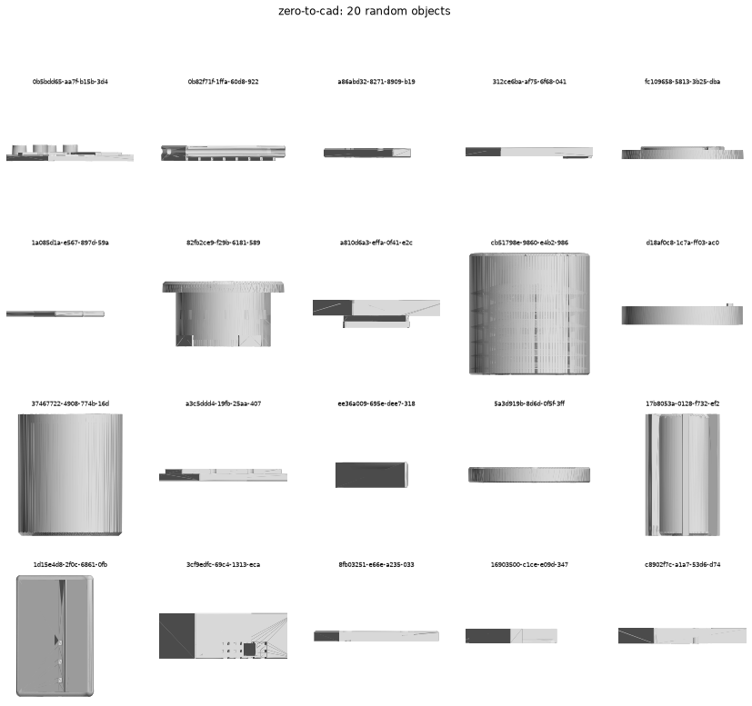 | 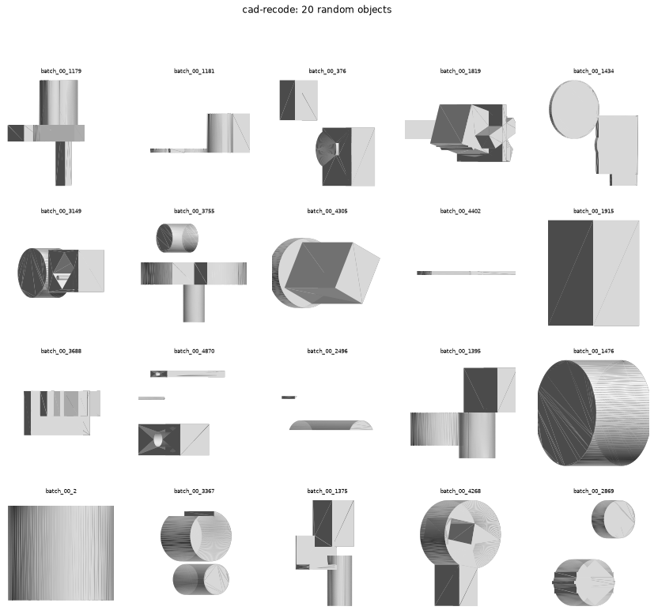 |
| 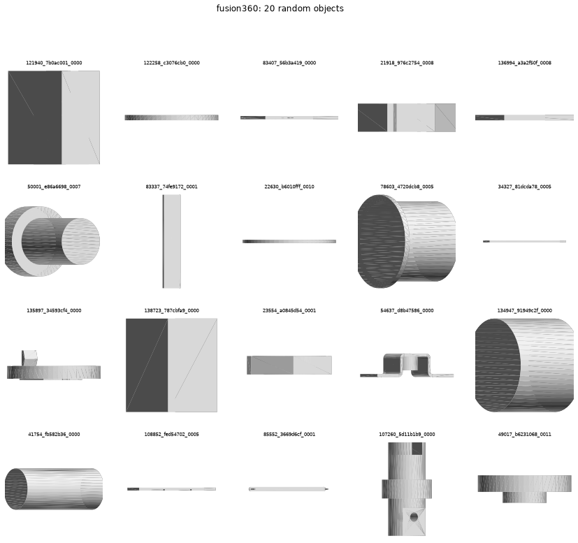 | 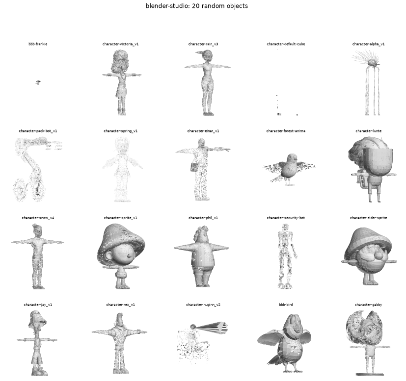 |
| 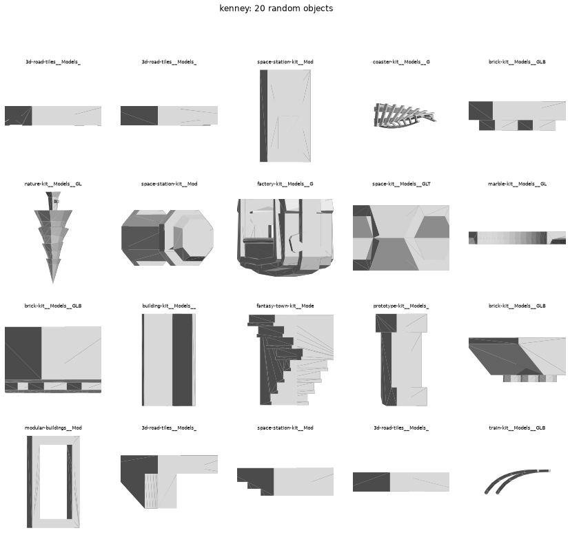 | 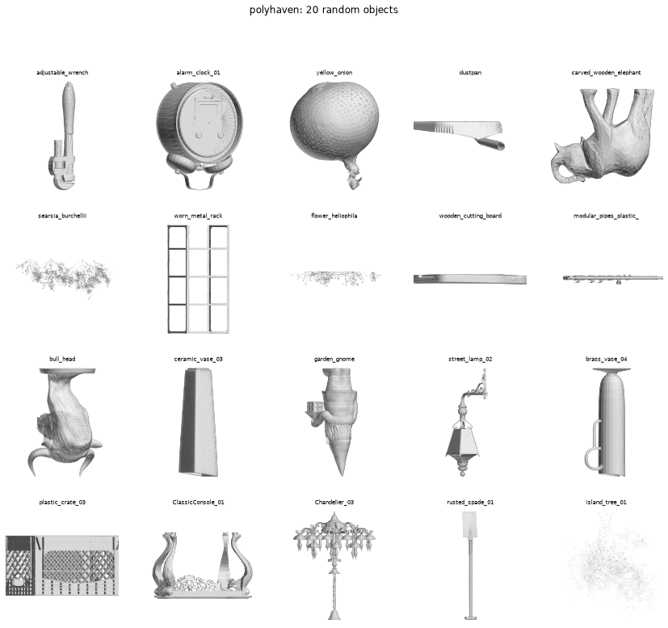 |
| 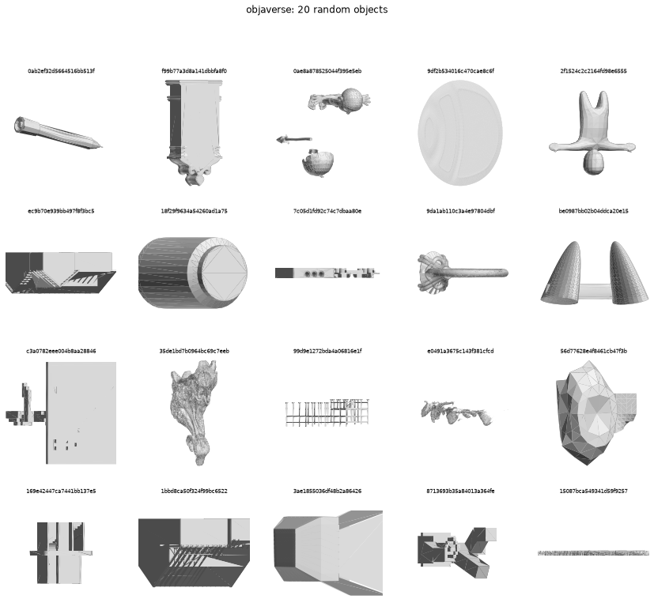 | 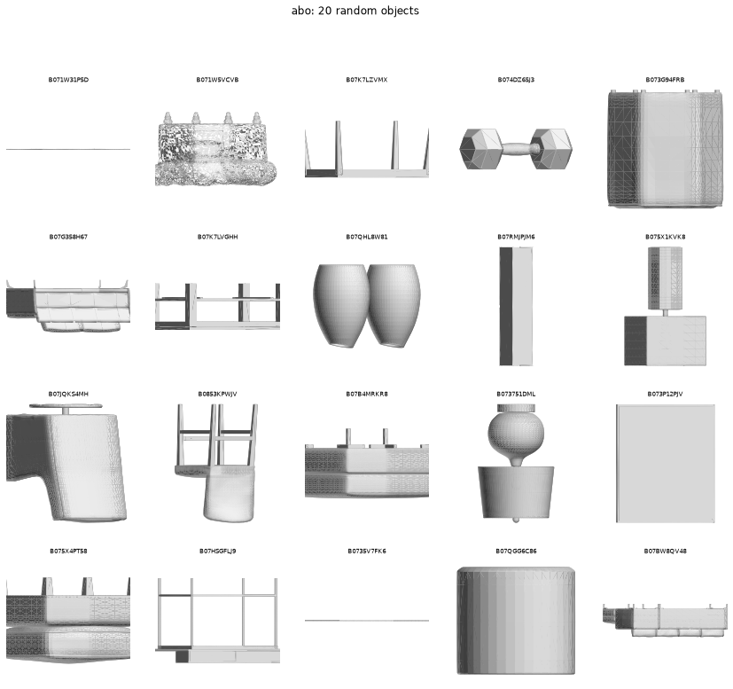 |
| 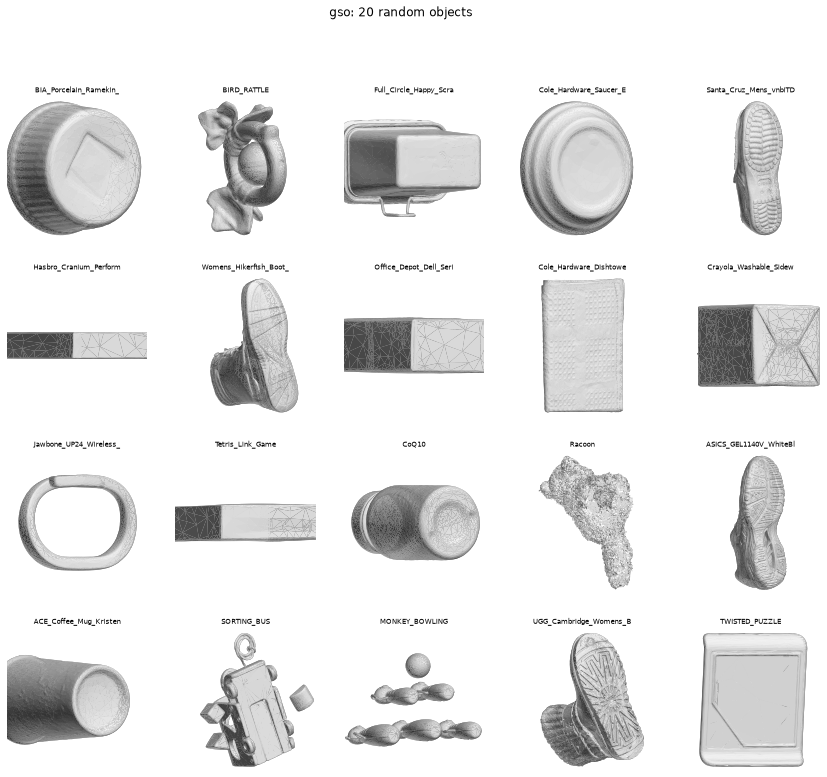 | 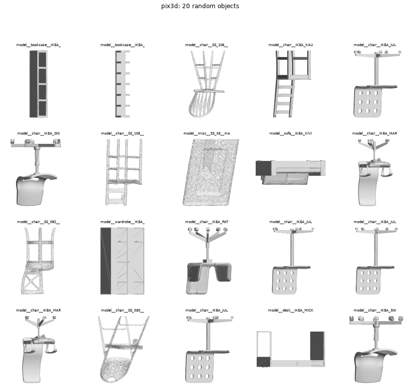 |
| 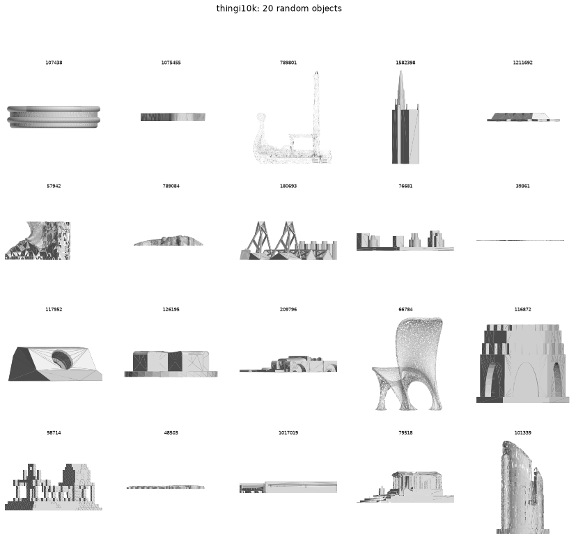 | |

DeepCAD has no meshes, so it has no sheet.

## gcad pairs

Exact (render, `.gcad`) pairs for inverse modelling, made from the Zero-to-CAD CadQuery programs. DeepCAD,
Fusion 360 and CAD-Recode are not translated: they are non-commercial and Zero-to-CAD alone gave 25k pairs.

Tools in `tools/datasets/to_gcad/`:

- `translate.py` runs each CadQuery program against a recording `Workplane` and `Sketch` that mirror the calls
  onto real CadQuery, so Python control flow, variables and loops are free. Anything it cannot express raises
  `Unsupported(<call>)` and the program is skipped with that reason.
- `pairs.py` translates, builds with `gcad export`, checks the shape, renders and appends to
  `out/pairs/results.jsonl` (resumable, 20 workers, niced). `report.py` writes `pairs.jsonl`, `report.json`
  and the contact sheet. `test_translate.py` has 10 hand-picked programs (one per op family), each built with
  gcad and checked with the shape distance, plus a rejection test: `python -m unittest test_translate`.
- `tools/datasets/shape_distance.py a.stl b.glb` prints volume error, bbox error, symmetric chamfer and
  Hausdorff (20k sampled points each, normalised by the bbox diagonal of the first mesh). It exits 0 when the
  volume is within 1% and the chamfer under 0.5% of the diagonal. `compare_meshes` and `verdict` are the reusable
  reward. The source volume is the exact B-rep volume from CadQuery; the mesh volume is the fallback.

Renders are 512 px: `iso`, plus orthographic `top`, `front`, `right` and `left` (the left view is the right view
of the file turned 180 degrees about z). `gcad render` draws a 2x2 sheet, which `pairs.py` cuts into cells.
`out/pairs/pairs.jsonl` has one line per pair: id, source, licence, commercial_ok, gcad path, renders,
source_render, line count, ops, shape distance and split. Splits hash the source object id (90/5/5), so no
shape crosses splits. Data is 2.2 GB under `out/pairs` and is not committed.

Result over all 100000 programs (3 h at 20 workers):

| stage | count | rate |
|---|---|---|
| translated | 59278 | 59.3% |
| built by gcad and compared | 29620 | 29.6% |
| kept (volume within 1%, chamfer under 0.5%) | 25325 | 25.3% of all, 42.7% of translated |

Splits: train 22807, val 1290, test 1228. A first 2000-program sample translated at 59% and kept 24%.
The metric is cheap and stable: a re-check of 150 random kept pairs passed all 150.

Op histogram of kept files (lines using each op): extrude 24292, plane 22576, rect 19082, chamfer 18052,
hole 12780, pen 8997, line 8995, close 8997, body 8012, combine 8012, fillet 7129, circle 6926, move 3617,
revolve 2157, arc 1157, axis 1088, rotate 1088, ngon 665, shell 536, loft 341, section 341, poly 334, slot 105.

Line count of kept files: min 2, median 12, p90 29, max 296 (the translator refuses more than 300 lines).
Histogram by tens of lines: 0-9 7234, 10-19 12813, 20-29 2790, 30-39 953, 40-49 506, 50-59 288, 60-69 167,
70-79 138, 80-89 64, 90-99 44, 100+ 328.

Top reasons for drops:

| reason | programs |
|---|---|
| shell on a selection other than extrude end faces (`unsupported:shell_selection`) | 13209 |
| sweep | 4131 |
| edge selectors with boolean logic or BoxSelector | 3971 |
| volume off by over 1% | 2203 |
| chamfer distance over 0.5% | 2088 |
| gcad boolean "invalid output shell" on `combine` | 2049 + 1914 + 1147 |
| `.add(...)` of a Workplane or wire | 1625 |
| `.sketch()` sub-API | 1551 |
| `.filter(lambda ...)` on edges | 1542 |
| fillet or chamfer on a face selection | 1145 |
| spline | 1037 |
| split | 1035 |
| `gcad export` over 40 s | 1032 |

Contact sheet of 20 random kept pairs (source render beside the gcad iso render):

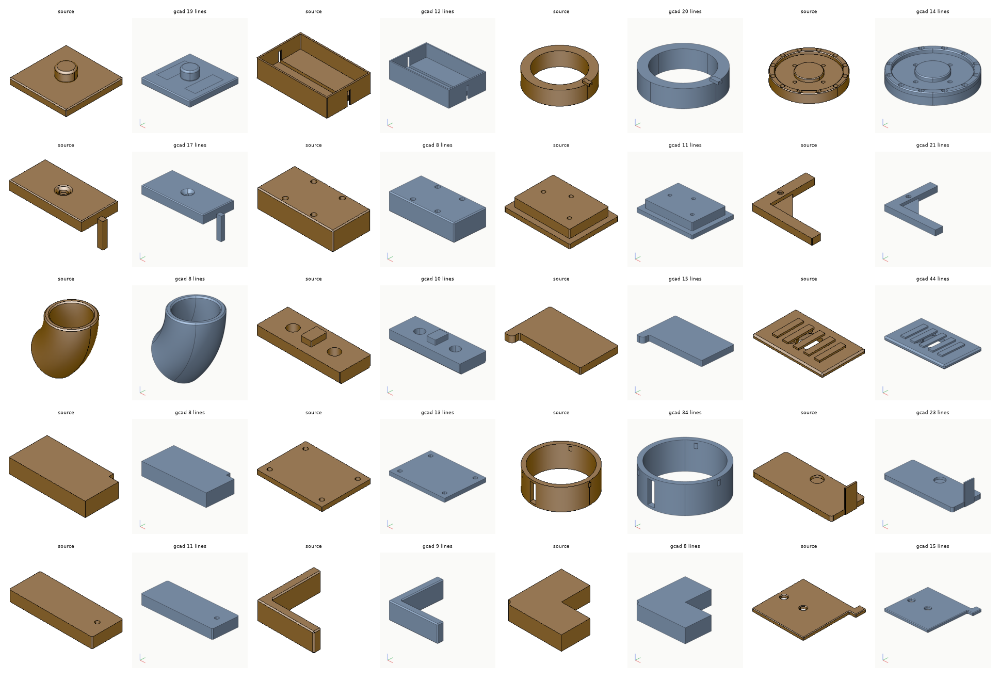

Gaps worth a later issue: shell selectors and sweep alone are 17% of the corpus; the combine failures show
gcad booleans failing on bodies that touch along faces CadQuery fuses happily.
